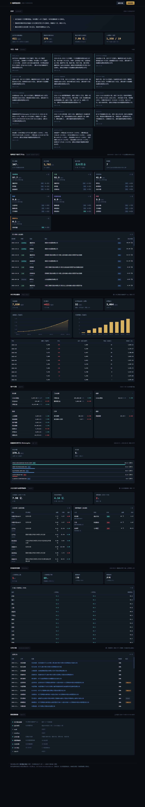

# 聪明钱雷达 · Smart Money Radar

追踪中国国家资本与产业资本动向的日更工具。输入是官方/半官方数据源，输出是**带溯源的、可验证的一句话**。



## 它回答什么问题

- 央行这个月买了多少黄金？按什么价买的？花了多少钱？
- 国家资本（梧桐树 / 中投）在海外买了什么？持仓怎么变的？
- 这两天谁在买 A 股？北向、社保、汇金、险资、公募各自买了什么？
- 大宗交易里机构专用席位在扫什么货？折价还是溢价？
- 金、银、铜、原油、股指、汇率、国债现在什么位置？

## 一句话长什么样

```
央行2026-10黄金储备 7,830 万盎司，环比 +83 万盎司（+25.8 吨），连续第 9 个月增持；
年内累计 +411 万盎司（+127.8 吨）；按当月 3,885 美元/盎司估算，本月购金耗资约 32 亿美元
（沪金 854.8 元/克）。 [源:SAFE官方储备资产|置信:高|滞后:0天]
```

```
2026-09-06~2026-11-05 期间，十大流通股东新进/加仓 347 笔，合计市值 1,782 亿元。
阵营：北向资金 41笔、公募 93笔、险资 9笔、社保养老金 15笔、外资 12笔。
最大单笔：澜起科技（加仓·北向资金）香港中央结算有限公司 持仓 38.4 亿美元。
[源:东方财富十大流通股东|置信:高|滞后:30天]
```

```
梧桐树投资平台 13F 2026-03-31→2026-06-30：持仓 4→5 只，市值 120→379 亿美元；
新建仓 1 只（最大 SPACE EXPLORATION TECHN CORP 263.4 亿美元）
[源:SEC 13F|置信:高|滞后:45天]
```

## 三道闸

工具的可信度来自三个硬约束，不是自我声明：

1. **无源不入库** —— `upsert_fact()` 拿不到 `source_url` 直接抛 `ValueError`
2. **每句必须带尾巴** —— `[源|置信|滞后]` 强制出现在输出里
3. **变化与状态分离** —— CHANGE（今日变化）和 STATE（当前状态）分开，日报只讲变化

## 快速开始

```bash
pip install -r requirements.txt

# 浏览器界面（推荐）
python -m smartmoney.web            # http://127.0.0.1:8848
python -m smartmoney.web --port 9000
python -m smartmoney.web --host 0.0.0.0

# 命令行
python -m smartmoney.cli run              # 全量采集 + 出报
python -m smartmoney.cli report           # 只出报，不采集
python -m smartmoney.cli report --out=reports\r.md
python -m smartmoney.cli signals          # 看历史信号

# 测试
python test_smartmoney.py                 # 6/6 通过，纯标准库
```

## 界面

十个板块：

| 板块 | 内容 |
|---|---|
| 总述 | 规则自动生成的三句话 + 4 个 KPI |
| 今日一句话 | 信号卡片，每张带溯源尾巴 |
| **聪明钱下场买了什么** | 按阵营拆的买入清单：北向/汇金/社保/国资/险资/外资/公募 |
| 央行黄金储备 | 双图（储备量 / 月度增量）+ 10 个月明细 + 购金成本估算 |
| **资产行情** | 16 个品种：金银铜钢、原油、6 大股指、汇率、国债 |
| 13F 持仓 | 横向条形图 + 新建/加仓/减仓标记 + 清仓名单 |
| 大宗交易与增减持 | 左右双表，按金额排序 |
| 区域房价指数 | 国家统计局 70 城，同比环比 |
| 公告扫描 | 带否定式/关键主体标记 |
| 数据源健康 | 逐源亮灯，失败标红 |

前端是单文件 HTML，图表手写 SVG，**零外部依赖**，断网也能看。

## HTTP 接口

全部 JSON，可脱离页面直接调：

| 方法 | 路径 | 内容 |
|---|---|---|
| GET | `/api/summary` | 总述 + 信号 + 健康 + 统计 |
| GET | `/api/smartbuy` | 聪明钱买入清单，按阵营分组 |
| GET | `/api/gold` | 黄金储备时序 + 购金成本估算 |
| GET | `/api/assets` | 多资产行情 |
| GET | `/api/region` | 70 城房价指数 |
| GET | `/api/holdings` | 13F 持仓 + 对比 |
| GET | `/api/trades` | 大宗交易 + 高管增减持 |
| GET | `/api/announcements` | 公告扫描 |
| POST | `/api/collect` | 触发采集 |

## 数据源状态

| 采集器 | 源 | 内容 | 频率 | 滞后 | 状态 |
|---|---|---|---|---|---|
| `safe_gold` | 外汇局官方储备资产 xlsx | 央行黄金储备 + 折美元 | 月 | 0 | ✅ 实测通 |
| `gold_price` | 东方财富月线 | 沪金9999 / COMEX | 日 | 0 | ✅ 实测通 |
| `multi_asset` | 东方财富行情 | 16 品种行情 | 日 | 0 | ✅ 实测通 |
| `smart_money_buy` | 东财十大流通股东 | 谁买/买什么/多少/什么阵营 | 季 | 30 | ✅ 实测通 |
| `cninfo` | 巨潮全文检索 | 减持/增持/回购/收储公告 | 日 | 0 | ✅ 实测通 |
| `insider_trades` | 东方财富高管持股 | 人名+股数+均价+金额 | 日 | 1 | ✅ 实测通 |
| `block_trades` | 东方财富大宗交易 | 买方席位/卖方/折溢价 | 日 | 1 | ✅ 实测通 |
| `sec_13f` | SEC EDGAR | 梧桐树/CIC 持仓 + QoQ | 季 | 45 | ✅ 实测通 |
| `stats70` | 国家统计局 70 城 | 分城市房价指数 | 月 | 20 | ✅ 实测通 |
| `house_price_city` | 中国房价行情网 | 分城市二手房均价 | 月 | 15 | ⚠️ 限流严重 |
| `land_deals` | 中国土地市场网 | 土地成交 | 日 | 7 | ❌ SPA 壳页 |

## 踩过的坑（重要）

这些是实测记录，能省后来人几天时间。

### SAFE 官方储备资产

详情页 HTML 里**没有表格**，数据在 xlsx 附件。附件链接要正则抓 `/safe/file/file/...xlsx`。

表头是 `项目 | 2026.01 | (空) | 2026.02 ...`，月份占**奇数列**；黄金储备量在单独一行，首列为空，值形如 `7419万盎司`。

**必须按列索引对齐。** 按非空值顺序取，会把「亿美元」列当成黄金量，产出一个看起来很真的假数字。这个坑我踩了两次。

### 聪明钱买入

- 公告标题抽金额行不通——标题只写「关于收购XX股权的公告」，金额全在 PDF 正文。
- 东财没有并购重组结构化报表，`RPT_MA_DEAL` / `RPT_ACQUISITION` / `RPT_SHARE_TRANSFER` 全部「报表配置不存在」。
- 能用的是 `RPT_F10_EH_FREEHOLDERS`（十大流通股东）。

两个必踩的坑：

1. **`香港中央结算有限公司` 就是北向资金。** 第一版归进「其他机构」，等于把最大一条外资线索扔了。修好后北向立刻成为最大阵营。
2. **不能按 `HOLDER_MARKET_CAP` 排序。** 按市值排会先捞出 2015 年汇金持有的建设银行 9300 亿。必须 `sortColumns=END_DATE&sortTypes=-1`，再按时间窗筛。

### 13F

`primary_doc.xml` 直接拼路径 404。正确走法：先取 `index.json`，从中找 `informationtable.xml`。报告期 `periodOfReport` 格式是 `MM-DD-YYYY`，要转 ISO。

### 其他

- **巨潮**：`hisAnnouncement/query` 返 0 字节，必须用 `fulltextSearch/full` + POST 表单 + `Referer`。
- **HKEX DI**：`di.hkex.com.hk` 返 1137 字节壳页（Akamai 拦截，带 `bm_s`/`bm_so` cookie 仍挡）；`hkexnews` 能建会话但 `recordCnt=0`。需 headless browser。
- **中国政府采购网**：连续请求触发「访问过于频繁」，返 2749 字节拦截页。
- **东方财富**：`DEAL_AMT` 是人民币元，接口不给美元，自己换。各品种 `f43` 放大倍数不同，需按 secid 分表。

## 能力边界

**能出准确数字**：央行黄金储备、金价、13F 持仓市值、大宗交易金额、高管增减持、十大股东新进加仓。

**只能出区间**：央行购金成本（月度增量 × 当月均价，误差 ±3%，央行不公布成交价，这是理论上限）。

**只能出方向**：家族办公室离岸层、代持、非上市股权。不要试图量化，会得到假精确。

**做不到**：政府「下场收房」（存量商品房收储）没有全国统一数据源。收储公告里 99% 是政府从企业收土地，不是从居民收商品房——标题都写「收储」，这是最容易混淆的地方。要做需逐城接地方公共资源交易中心。

## 目录

```
smartmoney/
  core.py        HTTP 会话 / SQLite / 归一化 schema / 幂等 id
  collectors.py  11 个采集器，单源失败不影响其他
  rules.py       事实 → 一句话 的规则引擎
  cli.py         命令行入口
  web.py         FastAPI + 静态页
  static/        单文件仪表盘（手写 SVG 图表，零依赖）
probes/          40 个数据源探测脚本，含实测结论
reports/         日报存档
screenshots/     界面截图
test_smartmoney.py
```

## 免责

数据全部来自公开可访问的官方/半官方源，仅做聚合与结构化。所有结论以原始出处为准，工具只是搬运和计算，不构成投资建议。
